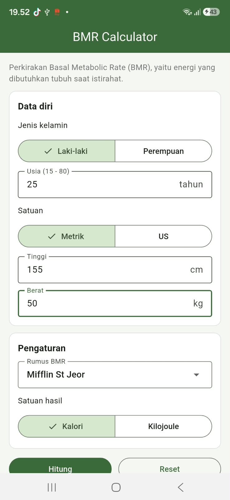
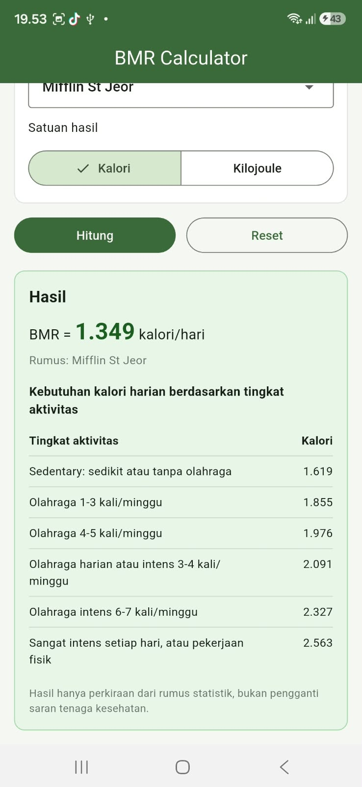

# BMR Calculator (Flutter)

## Anggota Kelompok

| No | Nama | NIM | Bagian |
|----|------|-----|--------|
| 1  | Adinda Putri Utami | K3524002 | Logika perhitungan, halaman utama, dan kotak hasil |
| 2  | Atikah Salsabila | K3524008 | Konstanta, kartu form, unit test, dan dokumentasi |
| 3  | Nadhira Zulsyifa S. | K3524082 | Konfigurasi project, tampilan awal, kolom input, tabel aktivitas, dan widget test |

## Deskripsi

Aplikasi Flutter untuk menghitung **Basal Metabolic Rate (BMR)**, yaitu perkiraan energi yang dibutuhkan tubuh saat istirahat. Project ini adalah pengembangan dari aplikasi BMI Calculator, dengan tampilan formulir satu halaman yang mengacu pada [calculator.net/bmr-calculator](https://www.calculator.net/bmr-calculator.html).

Fitur:

- Input usia (15-80 tahun), jenis kelamin, tinggi, dan berat badan
- Satuan metrik (cm, kg) atau US (feet/inch, pound)
- Tiga rumus: Mifflin St Jeor, Revised Harris-Benedict, dan Katch-McArdle (dengan input lemak tubuh)
- Hasil dalam kalori atau kilojoule
- Tabel kebutuhan kalori harian untuk 6 tingkat aktivitas
- Validasi input dan tombol reset
- Unit test dan widget test

### Rumus

| Rumus | Persamaan |
|-------|-----------|
| Mifflin St Jeor (pria) | 10W + 6,25H - 5A + 5 |
| Mifflin St Jeor (wanita) | 10W + 6,25H - 5A - 161 |
| Harris-Benedict (pria) | 13,397W + 4,799H - 5,677A + 88,362 |
| Harris-Benedict (wanita) | 9,247W + 3,098H - 4,330A + 447,593 |
| Katch-McArdle | 370 + 21,6 (1 - F) W |

W = berat (kg), H = tinggi (cm), A = usia (tahun), F = lemak tubuh (pecahan).

## Pembagian Tugas

| Anggota | File | Pekerjaan |
|---------|------|-----------|
| Dinda | `lib/calculator.dart`, `lib/components/result_card.dart`, `lib/pages/calculator_page.dart` | Tiga rumus BMR dan perhitungan kebutuhan kalori, halaman utama (form, validasi, tombol hitung dan reset), kotak hasil |
| Atikah | `lib/constants.dart`, `lib/components/section_card.dart`, `test/calculator_test.dart`, `README.md` | Enum, batas input, faktor aktivitas, kartu pembungkus form, unit test rumus, dokumentasi |
| Nadhira | `lib/main.dart`, `lib/components/activity_table.dart`, `lib/components/number_field.dart`, `test/widget_test.dart`, `pubspec.yaml` | Konfigurasi project dan tema, tabel kebutuhan kalori, kolom input angka, widget test |

## Struktur Project

```
bmr_calculator/
  pubspec.yaml
  analysis_options.yaml
  .gitignore
  README.md
  lib/
    main.dart
    constants.dart
    calculator.dart
    pages/
      calculator_page.dart
    components/
      number_field.dart
      section_card.dart
      result_card.dart
      activity_table.dart
  test/
    calculator_test.dart
    widget_test.dart
  android/ ios/ web/ linux/ macos/ windows/   (dibuat otomatis oleh Flutter)
```

## Alur Program

1. `main.dart` menjalankan aplikasi dan menampilkan `CalculatorPage`.
2. Pengguna mengisi form (gender, usia, satuan, tinggi, berat, rumus, satuan hasil) lalu menekan **Hitung**.
3. `CalculatorPage` memvalidasi input dan mengubah satuan US ke metrik bila perlu.
4. Objek `Calculator` menghitung BMR sesuai rumus yang dipilih, lalu menghitung kebutuhan kalori untuk tiap tingkat aktivitas.
5. `ResultCard` menampilkan BMR, dan `ActivityTable` menampilkan tabel kebutuhan kalori.

## Cara Menjalankan

1. Pastikan Flutter sudah terpasang (`flutter doctor`).
2. Clone repository ini, lalu masuk ke foldernya:
   ```bash
   git clone <link-repository>
   cd <nama-folder-repository>
   ```
3. Ambil dependency dan jalankan aplikasi:
   ```bash
   flutter pub get
   flutter run
   ```
4. Jalankan test (opsional):
   ```bash
   flutter test
   ```

Tidak ada package tambahan di luar bawaan Flutter.

## Screenshot

| Form | Hasil |
|------|-------|
|  |  |


## Catatan

Hasil hanya perkiraan dari rumus statistik dan bukan pengganti saran tenaga kesehatan.
